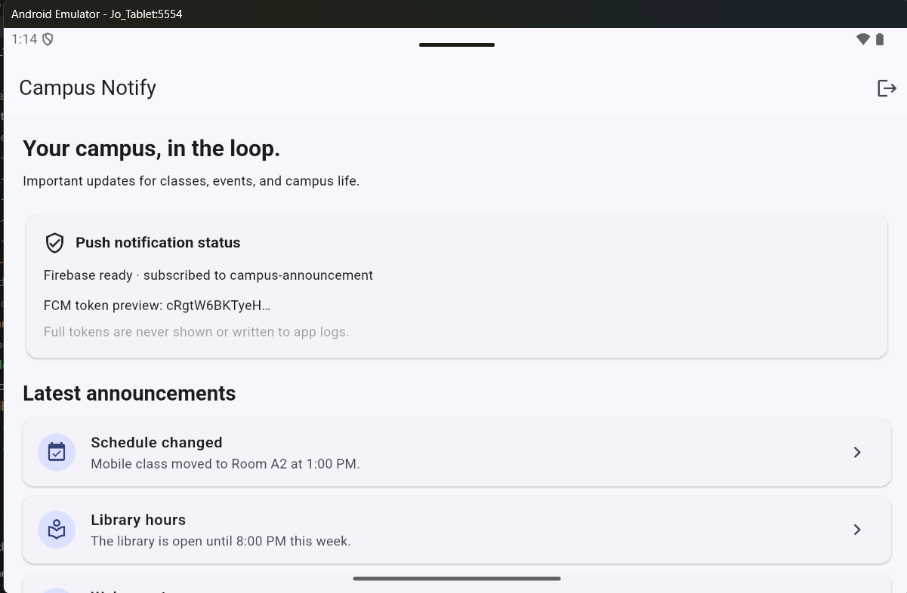
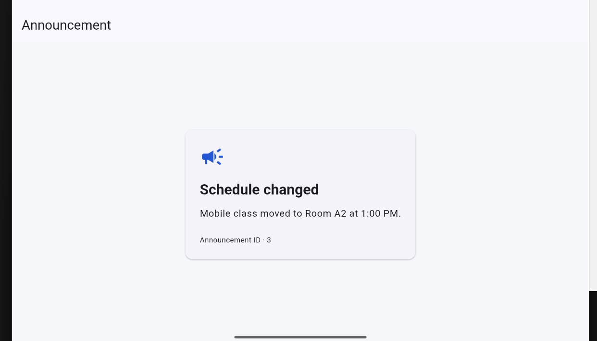
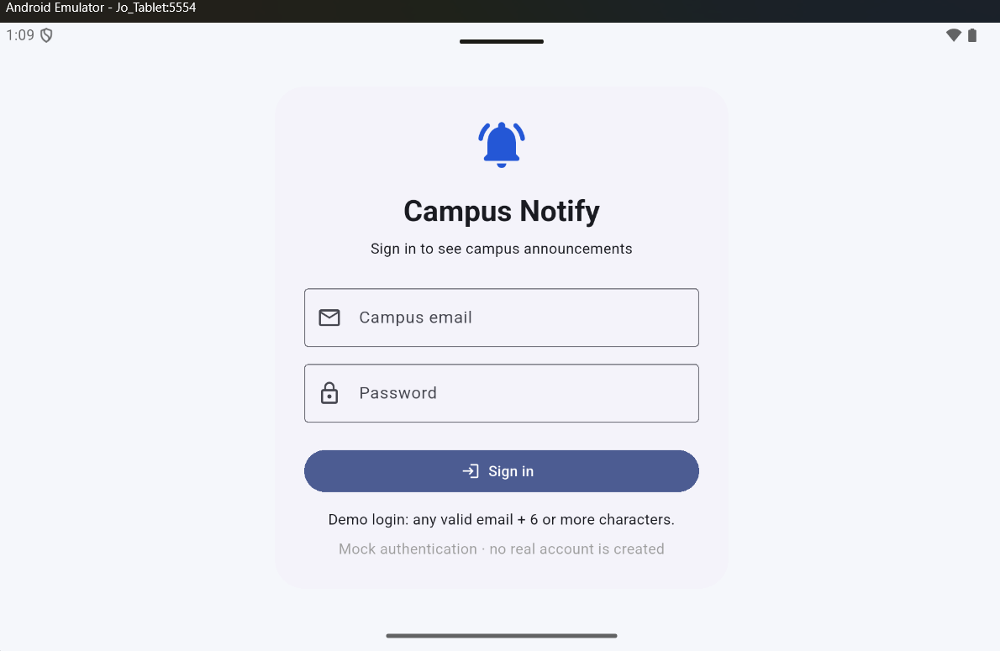
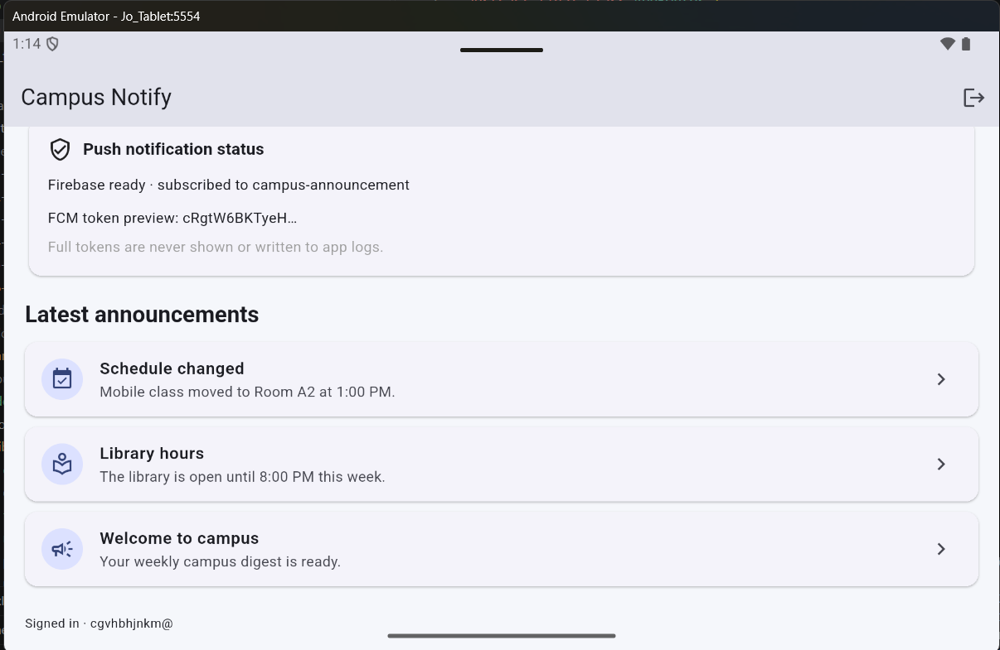

## Jobsheet: Matkul Mobile Programming Week 7

| *Informasi* | *Detail* |
| --- | --- |
| Mata Kuliah | Mobile Programming |
| Nama | Joseph Atem Deng Aruei |
| Absen | 17 |
| NIM | 244107020242 |


# Week 7 Clean Architecture refactor

This continues the existing Week 6 Campus Notify app. The app behavior is intended to stay the same: the three sample announcements, announcement detail routes, mock sign-in, secure token storage, Firebase push status, and notification deep links remain. The work moves responsibilities into feature-first layers.

## Objective and feature set

- Announcements: local data adapter, pure `Announcement` entity, domain repository contract, list/detail use cases, Riverpod providers, home list and detail page.
- Authentication: mock sign-in adapter, pure session entity, domain contract and `SignIn` use case, secure token data source, Dio refresh adapter, Riverpod auth state and login page.
- Core: pure FCM route parser and announcement date formatter.
- FCM lifecycle remains in `lib/messaging/`; it is initialized from app/router composition, not from an announcement widget.

## Layer diagram and dependency direction

```text
presentation (pages, Riverpod providers, router)
       | depends on
       v
 domain (entities, repository contracts, use cases, failures)
       ^ implemented by
       |
data (models, repository implementations, secure storage, Dio)
```

Dependencies point inward: presentation depends on domain; data implements domain contracts. Domain has no Flutter, Riverpod, Firebase, Dio, or storage imports. Riverpod providers wire implementations to interfaces. Widgets do not instantiate repositories or read secure storage directly.

## Week 6 audit and refactor map

| Before | Finding | Week 7 destination |
| --- | --- | --- |
| `lib/pages/home_page.dart` | Announcement rows and content were inline; page also read token storage and imported app bootstrap state | `features/announcements/presentation/pages/home_page.dart`; announcement data now comes from providers and account label from an auth provider. Push status lives in messaging. |
| `lib/pages/announcement_page.dart` | Detail lookup map lived inside `build` | `features/announcements/presentation/pages/announcement_page.dart`; content comes from the detail use case/provider. |
| `lib/data/auth_repository.dart` | Interface and mock implementation were the same class | `features/auth/domain/repositories/auth_repository.dart` plus `features/auth/data/repositories/mock_auth_repository.dart`. |
| `lib/data/api_client.dart` | Dio interceptor was in a generic root data folder | `features/auth/data/datasources/api_client.dart`; still refreshes only once and clears the session when refresh fails. |
| `lib/data/token_store.dart` | Secure storage was not grouped with auth | `features/auth/data/datasources/token_store.dart`. |
| `lib/providers/auth_provider.dart` | Provider wiring was separated from its feature | `features/auth/presentation/providers/auth_provider.dart`. |
| `lib/pages/login_page.dart` | Login UI was not grouped by feature | `features/auth/presentation/pages/login_page.dart`. |
| `lib/routes.dart` | Pure route constants and FCM data parsing were combined | Constants remain in `lib/routes.dart`; parser is now `lib/core/format.dart`. |
| `lib/messaging/push_service.dart` | Cross-cutting FCM infrastructure | Kept in `lib/messaging/`; push state is in `push_status.dart`. |


## Tests and verification

`test/features/announcements/domain/get_announcements_test.dart` uses a fake repository and covers success and failure without Firebase, Dio, or a database. `test/features/auth/domain/sign_in_test.dart` covers successful sign-in and validation failure. `test/auth_push_test.dart` covers route parsing, date formatting, mock auth, expired-refresh failure, and user-facing Dio errors.

Run from this folder:

```powershell
flutter analyze: Passed with no issues
flutter test: All tests passed
```


## AI Challenge and reflection

## Prompt used

> My Flutter project is `campus_notify` (auth + FCM + announcement list). Current state: `lib/{data, providers, pages, messaging}` folders, repositories mixed with implementations, widgets calling Dio directly.
> Tasks:
> 1. Propose a feature-first Clean Architecture structure (presentation/domain/data) for the auth + announcements features.
> 2. For each old file, state its new destination (move/split/delete).
> 3. Flag what would be over-engineered if applied to simple CRUD, and when a use case is truly needed versus repository straight to notifier.
> 4. Show Riverpod DI wiring (no extra DI package).
> Explain the trade-off of every decision.

## Initial AI proposal

The initial proposal was to split both features into `domain/`, `data/`, and `presentation/`; place entities, repository contracts, and operation-specific use cases in domain; place serialization models and concrete repositories in data; and construct the implementation and use cases in Riverpod providers. It also proposed moving route parsing to a pure utility and keeping FCM as an infrastructure service outside the announcement UI. Auth would keep secure token storage and the one-retry Dio interceptor in its data layer. Announcement data would remain a small local fixture because this repository has no announcements backend or database.

Proposed mapping:

| Existing file | Proposed destination | Decision |
| --- | --- | --- |
| `lib/data/auth_repository.dart` | Auth domain contract + `lib/features/auth/data/repositories/mock_auth_repository.dart` | Split interface from mock adapter; session model maps token data. |
| `lib/data/token_store.dart` | `lib/features/auth/data/datasources/token_store.dart` | Move secure-storage adapter to auth data. |
| `lib/data/api_client.dart` | `lib/features/auth/data/datasources/api_client.dart` | Move Dio/interceptor implementation to auth data. |
| `lib/providers/auth_provider.dart` | `lib/features/auth/presentation/providers/auth_provider.dart` | Keep Riverpod wiring/state at the presentation boundary. |
| `lib/pages/login_page.dart` | `lib/features/auth/presentation/pages/login_page.dart` | Move login UI. |
| Inline home announcements | Announcement entity, repository contract, local data adapter, use case, provider | Split hardcoded content out of widgets. |
| `lib/pages/announcement_page.dart` | `lib/features/announcements/presentation/pages/announcement_page.dart` | UI watches the detail provider. |
| `lib/routes.dart` | Keep route constants; move FCM route parsing to `lib/core/format.dart` | Make parsing independently testable. |
| `lib/messaging/push_service.dart` | Keep under `lib/messaging/` | FCM lifecycle is infrastructure; presentation only displays status. |
| `lib/data/api_errors.dart` | `lib/features/auth/data/api_errors.dart` | Keep Dio-specific error mapping next to auth/network infrastructure. |

## Proposal versus final decision

| Proposal | Final decision | Reason |
| --- | --- | --- |
| One use case per operation | Keep `GetAnnouncements`, `GetAnnouncement`, and `SignIn`; do not add use cases for token reads, logout, or topic subscribe | Listing/detail lookup is the selected announcement feature; sign-in validates and owns the authentication operation. Simple storage/topic calls do not gain useful policy from another wrapper. |
| Convert announcement fixtures to SQLite/API | Keep a local in-memory data adapter | No backend/database is part of this app, and the assignment is a refactor of working behavior, not a new feature. |
| Generic result with `Failure` | Keep `OperationResult<T>` and typed failures | It carries errors across the domain boundary without throwing raw Dio/Firebase/SQLite exceptions into widgets. |
| Use Firebase Auth | Keep mock authentication | This is the Week 6 demo; Firebase Auth credentials were not configured and changing auth would alter behavior. README labels it mock. |
| Widgets can read token store for user label | Rejected; expose `currentUserEmailProvider` | Secure storage access belongs behind presentation wiring, not inside a page. |
| Home page imports app bootstrap for FCM status/startup | Rejected; move status values to messaging module and start after router/auth setup | Breaks a page-to-root dependency and makes the widget less coupled to app composition. |
| Treat codelab screenshot files as new evidence | Rejected; preserve them as existing Week 6 evidence and request fresh after screenshots | Screenshots must show the actual refactored build and cannot be fabricated. |

## Final structure and dependency direction

```text
lib/features/announcements/presentation -> domain <- data
lib/features/auth/presentation         -> domain <- data
lib/core/format.dart                   pure route/date helpers
lib/messaging/                         Firebase lifecycle and notification events
```

Riverpod providers in each feature's `presentation/providers/` are the composition points. The announcement page watches `FutureProvider` state; the auth notifier calls `SignIn`; neither page constructs a repository. The domain folders import only project core/domain Dart files, not Flutter, Riverpod, Dio, Firebase, or storage packages.

## Technical rationale

An interface in domain lets business operations define the contract without depending on SQLite, Firebase, or HTTP. If the interface were in data, the domain use case would import an outer implementation package; replacing the storage adapter would force business code to change and tests would need infrastructure knowledge. Presentation depends inward on domain abstractions; the data adapter implements those abstractions; Riverpod performs the concrete wiring at the outside.

A use case is useful when an operation owns validation, coordination, policy, or a stable business action. A use case for every one-line CRUD method only adds files and indirection. A small team should call a repository from a notifier for a trivial pass-through; add the use case when rules need independent tests or the operation composes multiple dependencies. This refactor uses a sign-in use case for credential validation and a list/detail use case for the announcement feature. It intentionally does not add token-store or FCM topic use cases.

The entity has no `toMap`/JSON mapping. `AnnouncementModel` and `AuthSessionModel` own external representations; mapping happens at the data/domain boundary. Failures are simple domain values with UI-safe messages. Riverpod creates repository implementations, while widgets only read provider state.
### Initial proposal detail

The first pass proposed this concrete structure:

```text
lib/
  core/                 failures and pure format/route helpers
  features/
    auth/
      domain/{entities,repositories,usecases}/
      data/{models,repositories,datasources}/
      presentation/{providers,pages}/
    announcements/
      domain/{entities,repositories,usecases}/
      data/{models,repositories}/
      presentation/{providers,pages}/
  messaging/            FCM handlers, notification channel, token events
  main.dart             Firebase boot and GoRouter composition
```

It recommended Riverpod as the only dependency-injection mechanism:

```dart
final announcementRepositoryProvider = Provider<AnnouncementRepository>(
  (ref) => AnnouncementRepositoryImpl(),
);
final getAnnouncementsProvider = Provider<GetAnnouncements>(
  (ref) => GetAnnouncements(ref.watch(announcementRepositoryProvider)),
);
final announcementsProvider = FutureProvider((ref) async {
  final result = await ref.watch(getAnnouncementsProvider)();
  if (result.failure case final failure?) throw failure;
  return result.value!;
});
```

It recommended keeping `SignIn` because credential validation is domain policy; using a repository directly for trivial token reads, logout, topic subscribe/unsubscribe, or a one-line lookup would add indirection without a business rule. It recommended adding persistence only after a real API or database exists. These recommendations were then checked against the actual Week 6 files and adjusted in the final-decision table above.

- **Why is the repository interface in domain?** Domain owns the operation contract. If it lived in data, business logic would depend on an outer implementation layer, so changing storage would leak into use cases and tests.
- **When is a use case needed?** Use it when it owns validation, policy, coordination, or a reusable business operation. A pure one-line pass-through can go from notifier to repository.
- **What does one use case per CRUD operation cost?** More files, navigation, and maintenance for little policy value on a small team. It becomes worthwhile when operations need independent rules/tests or coordinate multiple sources.
- **What AI proposal was rejected or simplified?** I rejected pushing token-store reads into a page and rejected adding database/API and use-case wrappers for simple token/topic operations. The app has no real announcements backend, so the existing local sample content remains behind a repository adapter.

## Before/after screenshot evidence

- `screenshots/after-announcements-home.png` —  
- `screenshots/after-announcement-detail.png` — 
- `screenshots/after-auth-login.png` — 
- `screenshots/after-auth-home.png`. 

