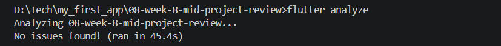
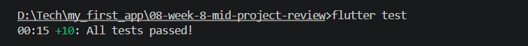
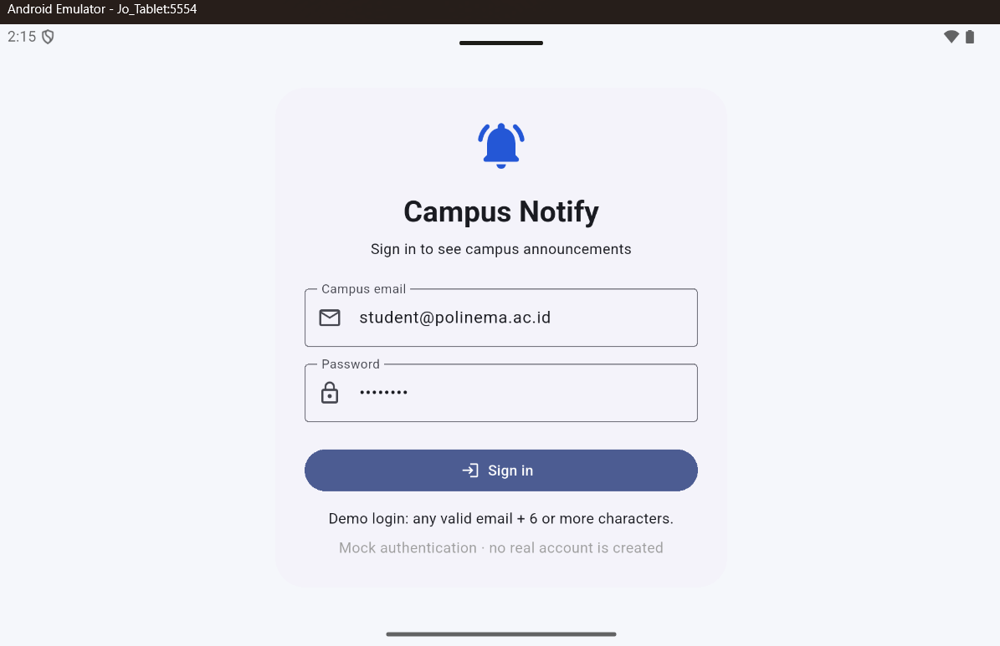
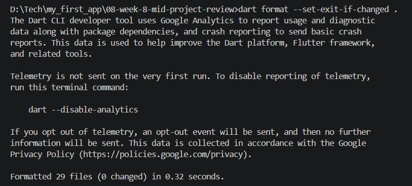
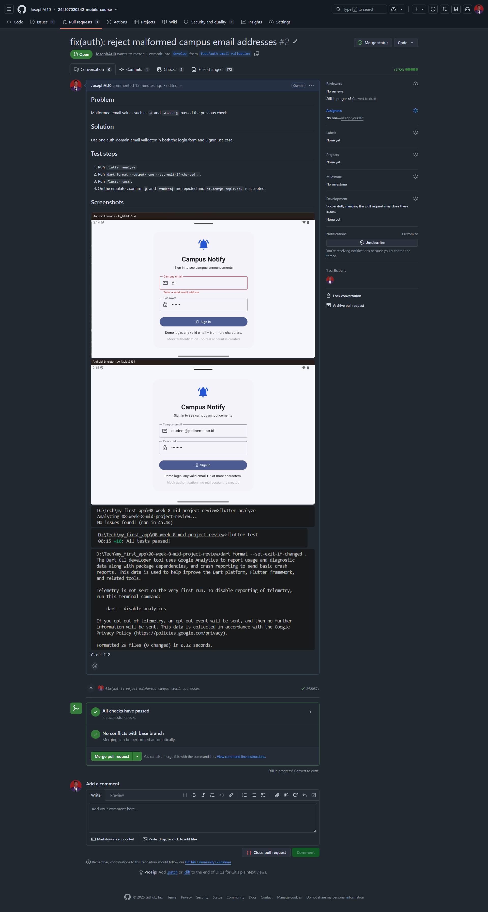
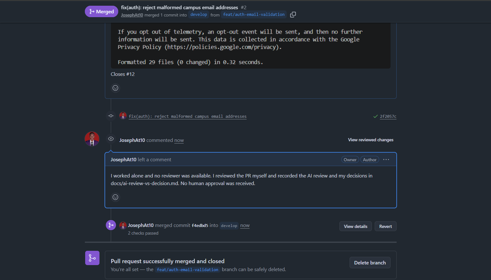

## Jobsheet: Matkul Mobile Programming Week 8

| *Informasi* | *Detail* |
| --- | --- |
| Mata Kuliah | Mobile Programming |
| Nama | Joseph Atem Deng Aruei |
| Absen | 17 |
| NIM | 244107020242 |

## Objective and result

This folder continues the Campus Notify Flutter app and records the Week 8 review work: reject malformed campus email addresses, verify the change, and document the GitHub issue, pull request, CI, and AI review decisions.

The auth validation change is implemented and merged to `develop` in [PR #2](https://github.com/JosephAt10/244107020242-mobile-course/pull/2), linked to [Issue #12](https://github.com/JosephAt10/244107020242-mobile-course/issues/12). GitHub Actions passed. The PR was completed solo because a classmate reviewer was unavailable; the self-review and AI review are recorded, and no human peer approval is claimed. The PR comparison included 172 files because this folder contains the project snapshot as well as the validation change, so it exceeded the codelab’s small-PR target.

## What changed

The login form and the `SignIn` use case share one pure auth-domain email validator. It accepts a basic address shape such as `student@polinema.ac.id` and rejects malformed values such as `@` and `student@`. Passwords are not trimmed because whitespace can be part of a credential.

The app retains its Campus Notify functionality: mock sign-in, guarded navigation, announcement list and detail pages, secure token storage, one-retry Dio refresh handling, and Firebase Messaging integration. Mock sign-in does not create a Firebase Auth account or issue production tokens.

## Architecture and stack

```text
presentation (Flutter pages, Riverpod providers, GoRouter)
       ↓
domain (entities, repository contracts, use cases, validation)
       ↑
data (models, repository implementations, Dio, secure storage)
```

Dependencies point inward: presentation depends on domain abstractions; data implements domain contracts; Riverpod wires implementations at the presentation boundary. The domain layer does not depend on Flutter, Dio, Firebase, or storage packages.

Stack: Flutter/Dart, Riverpod, GoRouter, Dio, `flutter_secure_storage`, Firebase Core/Messaging, and `flutter_local_notifications`.

## Run

Open `08-week-8-mid-project-review/` in VS Code, then run:

```powershell
flutter pub get
flutter analyze
dart format --set-exit-if-changed .
flutter test
flutter run
```

For FCM checks, use Android with Google Play services and configure `android/app/google-services.json`. Sign-in is mock authentication; any valid email and a password of at least six characters work.

## Verification

The captured terminal evidence shows:

- `flutter analyze` — passed, no issues found.
- `flutter test` — passed, all tests passed.
- `dart format --set-exit-if-changed .` — passed, 29 files formatted, 0 changed.
- GitHub Actions `Week 8 Flutter CI` — successful for PR #2.

The email form screenshots show malformed and valid input behavior. The PR and merged-PR screenshots show the review record and merge to `develop`. The available screenshots are embedded below.

## Issue, PR, and review record

- Issue: [#12 — reject malformed campus email addresses](https://github.com/JosephAt10/244107020242-mobile-course/issues/12).
- Pull request: [#2 — fix(auth): reject malformed campus email addresses](https://github.com/JosephAt10/244107020242-mobile-course/pull/2), merged into `develop`.
- CI: `Week 8 Flutter CI`, successful.
- Review: completed solo with a documented self-review and AI review because a peer was unavailable. This records the actual review process; it is not represented as peer approval.
- Scope: the PR comparison shows 172 changed files; the codelab recommends a small one-feature PR. The validator change itself is focused, but the submitted PR also carries the Week 8 project snapshot.

Detailed records:

- [Review checklist and issue/PR record](docs/review-checklist.md)
- [AI review prompt, output, and final decisions](docs/ai-review-vs-decision.md)
- [Pull request template](docs/pull-request-template.md)

## Screenshots

### Email validation and app








### Formatting and CI evidence



The successful GitHub Actions run is shown in the PR evidence below.

### Pull request and merge






## AI review versus final decision

## Prompt used

> Review this Flutter PR as a senior Flutter dev.
> Context: feature-first Clean Architecture (presentation → domain ← data),
> Riverpod, GoRouter, SQLite + Dio.
> Focus: correctness, architecture, tests. Ignore style.
> Give the top 5 findings + severity (blocker/suggestion) + rationale + proposed code fix.

The actual Week 8 change is a shared Campus Notify auth email-shape validator. SQLite is part of the supplied codelab prompt; this app's announcements remain local fixtures and do not use SQLite.

## Initial AI review output

This is the first-pass review output generated by the AI assistant for the Week 8 change, before the verification/decision table below:

1. **[Blocker] The email check is too permissive.** Checking only for `@` lets values such as `@` and `student@` reach the sign-in operation. Add a pure validation rule that requires a local part, `@`, a domain, and a dot suffix; use it at the domain boundary and in the form.
2. **[Suggestion] The UI and domain duplicate the email rule.** If the two checks are maintained independently, they can drift and the form may claim a value is acceptable only for the use case to reject it (or vice versa). Put one pure validator in the auth domain and have both call it.
3. **[Blocker] The Dio interceptor retries 401 responses without a limit.** Retry is potentially recursive; add a retry marker or a maximum attempt counter.
4. **[Suggestion] Trim passwords before sending them to authentication.** This would normalize accidental whitespace and reduce login failures.
5. **[Suggestion] Use a full RFC 5322 email parser/package.** A short regular expression cannot validate every legal email address.

## Proposal versus final decision and evidence

| AI finding | Decision | Evidence / rationale |
| --- | --- | --- |
| Email check accepts malformed strings | **Accepted and fixed** | Before the change, `SignIn` and the form only checked `contains('@')`. The new `isValidCampusEmail` requires a local part, domain, and dot suffix. Unit cases cover a valid address, surrounding whitespace, `@`, and `student@` in `test/features/auth/domain/sign_in_test.dart`. |
| Form and use case duplicate the validation policy | **Accepted and fixed** | The form now imports the domain validator, and `SignIn` uses the same function. There is one rule to test and maintain instead of two copies. See `lib/features/auth/presentation/pages/login_page.dart` and `lib/features/auth/domain/usecases/sign_in.dart`. |
| Dio retries a 401 indefinitely | **Rejected as a false positive** | `lib/features/auth/data/datasources/api_client.dart` adds `extra: {...request.extra, 'retried': true}` to the retry and forwards a later 401 instead of retrying it. The proposed finding is contradicted by the retry guard. |
| Trim passwords | **Rejected** | Passwords are opaque credentials. Trimming can silently change a valid password whose first or last character is a space. The use case deliberately preserves the password exactly; it checks length but passes the original value to the repository. |
| Add an RFC 5322 parser package | **Deferred / simplified** | This is a mock-auth classroom app and the rule is explicitly a basic shape check, not proof that an address exists. A package adds dependency and policy complexity without authenticating a real account. A production backend remains responsible for account validation. |

## Final decision

Accepted the two findings that address the observed weak rule and the duplicated validation policy. Rejected the alleged unlimited retry because the source already has a one-retry marker. Rejected password trimming because it can alter credentials. Kept the email rule intentionally simple and documented its limit. These decisions apply to this code and can be checked in the cited files; they are not a claim that a human peer has approved or merged the PR.

## Verification record

The captured Week 8 terminal evidence records these successful checks:

- `flutter analyze`: passed; no issues found (`screenshots/1.png`).
- `flutter test`: passed; all tests passed (`screenshots/2.png`).
- `dart format --set-exit-if-changed .`: passed; 29 files, 0 changed (`screenshots/7.png`).
- GitHub Actions `Week 8 Flutter CI`: successful for PR #2 (`screenshots/9.png`).

The emulator evidence shows `@` and `student@` rejected and a valid campus email entered in the form (`screenshots/3.png`, `4.png`, and `5.png`). The merged PR and solo-review note are shown in `screenshots/10.png`. The change was self-reviewed because a peer reviewer was unavailable; AI suggestions were independently checked against the code and tests, and this is not represented as human peer approval.
