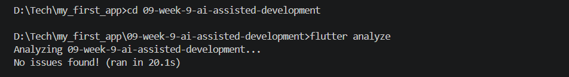
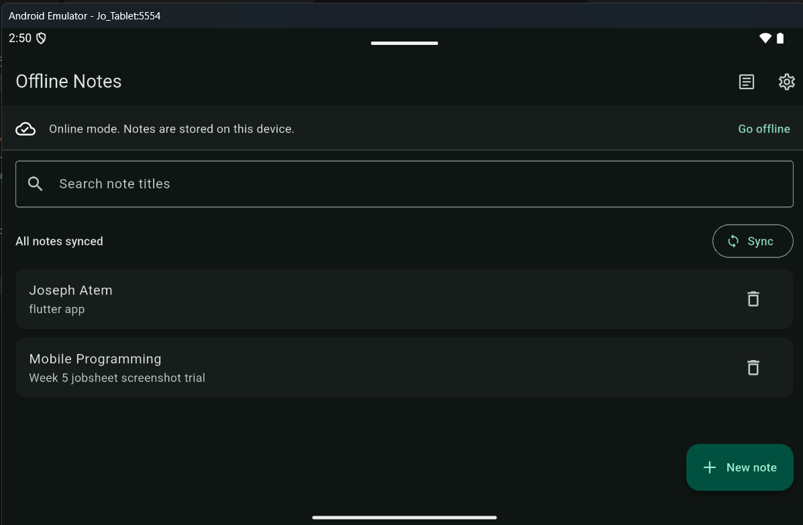
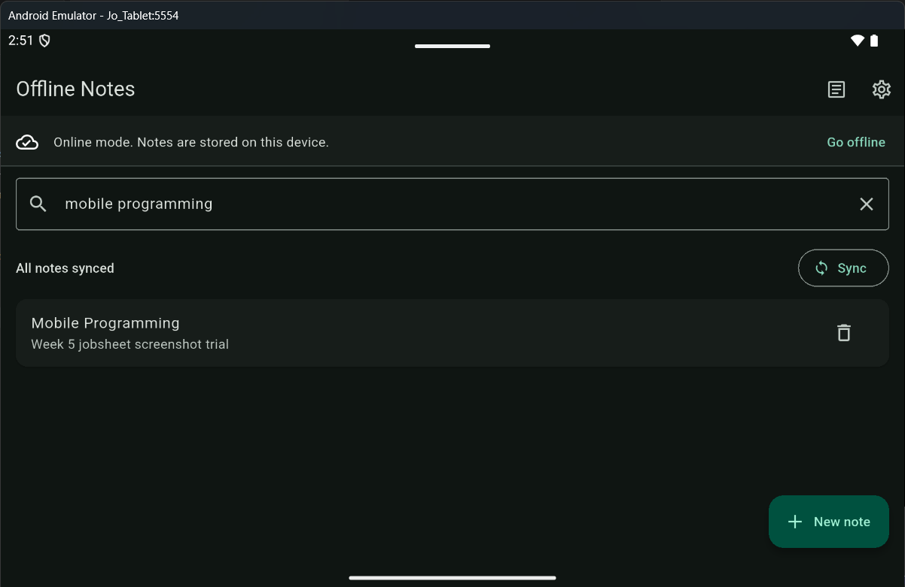
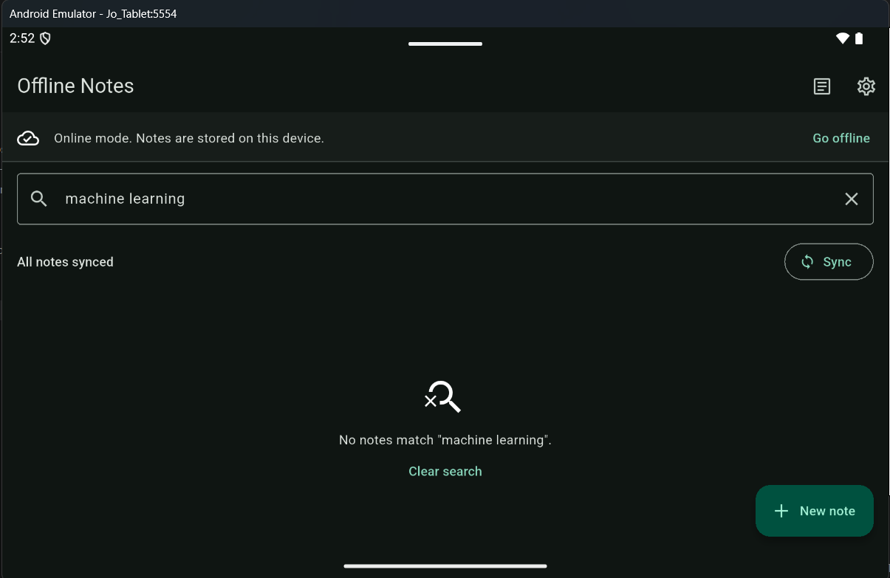
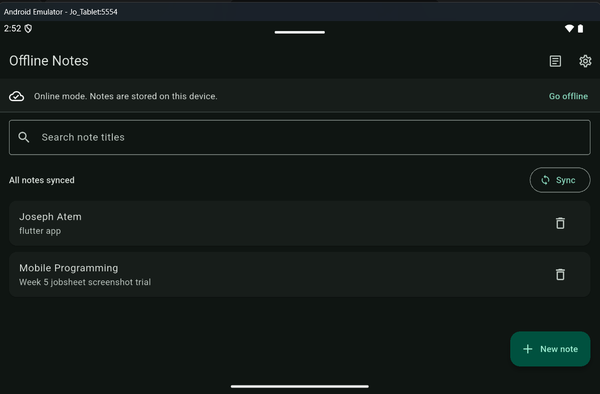

## Jobsheet: Matkul Mobile Programming Week 9

| *Informasi* | *Detail* |
| --- | --- |
| Mata Kuliah | Mobile Programming |
| Nama | Joseph Atem Deng Aruei |
| Absen | 17 |
| NIM | 244107020242 |

This continues the Week 5 Offline Notes Flutter app. The Week 9 change adds title search with a clear no-results state. Search ignores letter case and surrounding query spaces; an empty query shows all notes, and note bodies are not searched.

## Feature and architecture

The search follows the existing Riverpod app structure and keeps filtering independent from Flutter and SQLite:

```text
NotesPage (query input and rendering)
    -> Riverpod search provider
        -> FilterNotes domain use case
            -> Note domain entity

SQLite rows <-> NoteModel (data mapping) -> NoteRepository -> Note entity
```

- `lib/features/notes/domain/entities/note.dart` is the plain note entity.
- `lib/features/notes/domain/usecases/filter_notes.dart` contains the case-insensitive, trimmed title filter.
- `lib/features/notes/presentation/providers/search_providers.dart` wires the use case through Riverpod.
- `lib/features/notes/presentation/widgets/no_search_results.dart` displays a no-match message and clear action.
- `lib/pages/notes_page.dart` owns the search text and displays the filtered notes.
- `lib/data/local/note.dart` maps SQLite rows through `NoteModel`; data mapping stays out of the domain.

The existing note creation, editing, deletion, offline storage, and sync demo are retained.

## Tech stack

- Flutter and Dart
- Riverpod 2 for application state and dependency wiring
- SQLite through `sqflite` for notes
- SharedPreferences for small settings
- GoRouter for app routes

No new package is needed for search.

## Run the app

Open this folder in VS Code or a terminal, then run:

```sh
flutter pub get
flutter analyze
flutter test
flutter run
```

Use an Android emulator or device for the manual UI evidence. On the notes screen, create or use notes with distinct titles, then try an exact match, a different-letter-case match, and a query with no match. Clear the query to restore the full list.

## Tests and AI challenge

Automated coverage includes title matching with case and whitespace normalization, blank-query behavior, no-match behavior, title-only matching, and the no-results widget's clear action. See `test/features/notes/domain/filter_notes_test.dart` and `test/features/notes/presentation/no_search_results_test.dart`.

The AI challenge prompt, safe project context, initial proposal, verified hallucination, accept/reject decisions, manual refactors, and reflection are recorded in [`docs/ai-log.md`](docs/ai-log.md). The specific false claim was that Dart `String.contains` performs case-insensitive matching; the mixed-case regression test demonstrated the failure, and the final use case normalizes both strings.

## Verification results

`flutter analyze` completed with no issues.



`dart format --output=none --set-exit-if-changed .` confirmed all 19 Dart files are formatted.


`flutter test` passed all 9 tests.


## Emulator screenshots

The screenshots below show the running app before search, a lowercase query matching a capitalized title, the no-match state, and the restored list after clearing the query.









## Result

The notes list can be searched by title without moving search rules into the widget or database layer. The use case is independently testable, while the existing SQLite persistence and Riverpod UI remain in place. The terminal checks and emulator behavior are shown above.
