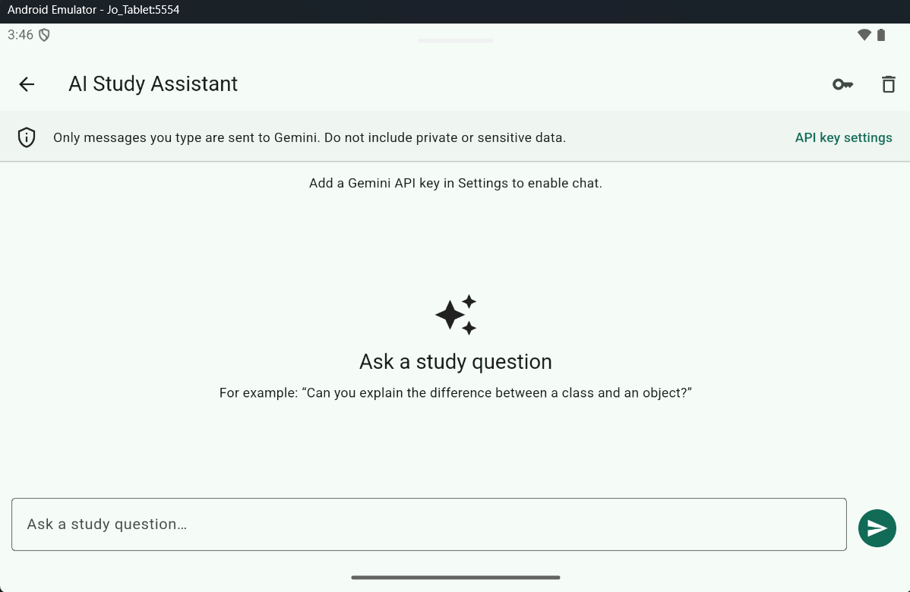
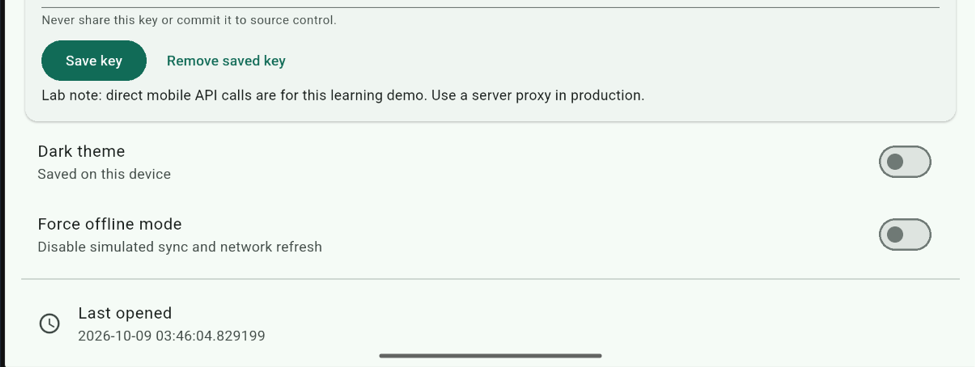
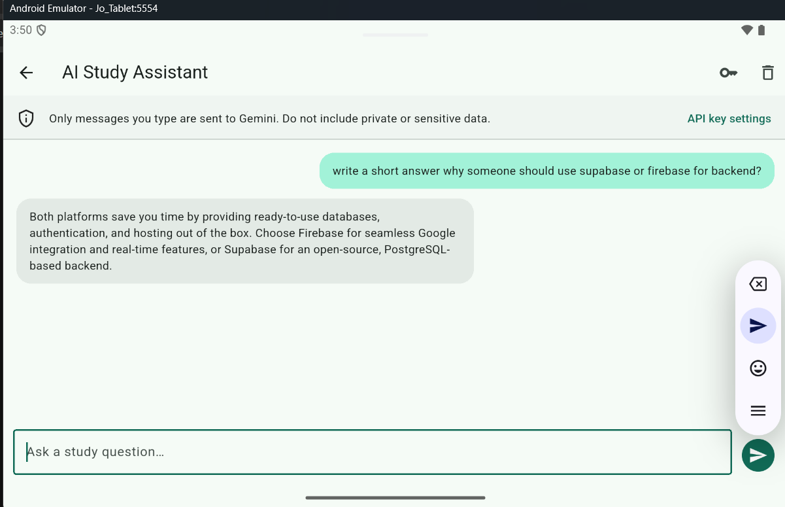
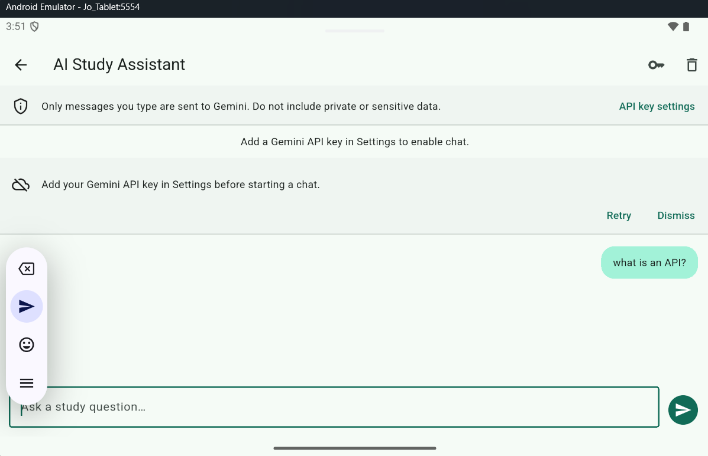
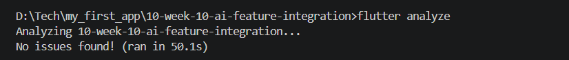
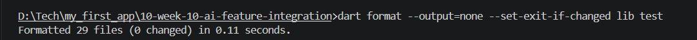

## Jobsheet: Matkul Mobile Programming Week 9

| *Informasi* | *Detail* |
| --- | --- |
| Mata Kuliah | Mobile Programming |
| Nama | Joseph Atem Deng Aruei |
| Absen | 17 |
| NIM | 244107020242 |

## Jobsheet report

This project extends the existing Week 5–9 Offline Notes app with one AI feature: a streamed study-question chat using the Gemini API. Notes, title search, SQLite persistence, and the existing offline/sync demo remain part of the app.

## Feature and behavior

- Open **AI study chat** from the notes screen and ask a study question.
- See the answer stream into a chat bubble, with a loading indicator before the first token.
- Configure or remove the Gemini key in **Settings**. The full key is never displayed after saving.
- The app sends only the text conversation to Gemini; it does not send saved notes, account details, or other local data.
- The assistant is asked to answer clearly in up to two short sentences and to direct uncertain campus-specific questions to official sources.
- Requests are bounded to 1,000 characters per message, the latest 11 turns, 256 generated tokens, and 20 attempts per local device per day.
- Network, timeout, empty-response, invalid-key, and rate-limit errors have user-facing messages and a retry action. Existing notes remain available offline.
- Chat history stays in memory for the current screen and is cleared when the screen is closed or the user clears it. No prompt or response is written to app logs or persistent storage.

## Architecture and tech stack

```text
NotesPage --GoRouter--> AiChatPage (Flutter UI)
                              |
                         Riverpod provider
                              |
                    ChatRepository (domain)
                              ^
                              |
            GeminiChatRepository (data: HTTP/SSE)
                |                         |
       SecureApiKeyStore        SharedPreferences quota
```

- Flutter and Dart
- Riverpod for dependency wiring
- `http` for the Gemini REST streaming request (Server-Sent Events)
- `flutter_secure_storage` for the user-entered API key
- SharedPreferences for a per-install daily request counter
- Existing GoRouter, SQLite, and SharedPreferences note features

## Setup and run

From this folder, run:

```sh
flutter pub get
flutter analyze
dart format --output=none --set-exit-if-changed lib test
flutter test
flutter run
```

On the Android emulator, open **Settings**, paste a Gemini API key from Google AI Studio, and save it. Then return to the notes page, tap the sparkle/chat icon, and ask a non-sensitive study question. The app uses the `gemini-3.5-flash-lite` model through Gemini's `streamGenerateContent` endpoint.

If the API key is absent or invalid, the app explains how to configure it. If the network or service is unavailable, retry later and continue using the local notes app. Do not put a real key in source code, screenshots, issues, or commits.

## AI privacy, cost, and reliability risk table

| Risk | Mitigation in this lab app | Remaining limit |
|---|---|---|
| User data leakage | Only typed chat messages go to Gemini; notes and personal records are not attached. The UI warns users not to enter sensitive data. | Anything typed into chat is sent to Google's API. Do not use private or regulated data. |
| API key exposure | User enters their own key; it is stored with platform secure storage and sent in the HTTPS `x-goog-api-key` header. It is excluded from source, URL query parameters, logs, and chat history. Android backup is disabled to avoid restoring encrypted key data without its device key. | A mobile client key can still be extracted from a running app. Secure storage protects it at rest; it does not make a client-side key safe for a public production app. Production should call a backend proxy and keep the provider key on the server. |
| Cost or request spikes | 20-request-per-day local device cap, 1,000-character input cap, at most 11 conversation messages per request, and 256 output tokens. | The client-side counter can be reset or bypassed. Set provider-side quotas/billing alerts or enforce quotas on a backend before public release. |
| API error or network outage | Friendly status-specific error, timeout handling, retry action, and notes remain usable offline. | A retry still requires the provider API and connectivity to recover. |
| Irrelevant or incorrect response | The system instruction limits response length and asks the assistant to acknowledge uncertainty; official campus sources are recommended for campus-specific facts. | Generative answers can still be wrong. Verify consequential information independently. |

## Tests and verification

Automated tests cover the daily request policy, Gemini SSE chunk parsing and request headers, missing-key behavior, and the existing Week 9 notes/search behavior. The current results are:

- `flutter analyze`: **passed** — no issues found.
- `dart format --output=none --set-exit-if-changed lib test`: **passed** — 29 Dart files checked, 0 changed.
- `flutter test`: **passed** — all 13 tests passed.
- `flutter build apk --debug`: attempted; Gradle could not establish a loopback connection in the current execution environment, so an APK build was not verified here.

## Reflection

- **AI feature and reason:** A streamed study-question chat adds interactive explanations to an existing notes app while leaving saved notes local.
- **Privacy:** The app sends only the text entered in the chat, warns against sensitive data, keeps messages in screen memory, and stores the Gemini key with platform secure storage. A backend proxy is needed before using a shared key in a production app because mobile client keys can be extracted.
- **Fallback:** Missing/invalid key, rate limit, service failure, malformed/empty reply, timeout, and lost connectivity produce a clear message and retry path. The user can continue using locally stored notes while the AI service is unavailable.
- **Mobile AI UX lesson:** Streaming makes progress visible, but it needs a loading state, short messages, a nearby privacy reminder, and a usable error path. Model answers still need independent checking.

## Screenshots

### AI chat empty state


### Secure API key settings


### Streamed study response


### Error fallback


### Automated checks


## Result

The app adds a small AI study chat while keeping existing notes local and available offline. The provider key is not bundled in code; requests are bounded and errors have a clear fallback path. This is a learning integration, not a production architecture for a shared provider key.

## References

- [Gemini API: streaming content generation](https://ai.google.dev/api/generate-content)
- [Gemini API: API key safety](https://ai.google.dev/gemini-api/docs/api-key)
- [Gemini API model names](https://ai.google.dev/gemini-api/docs/models)
- [flutter_secure_storage](https://pub.dev/packages/flutter_secure_storage)
- [http package](https://pub.dev/packages/http)
- [Riverpod](https://riverpod.dev/)
