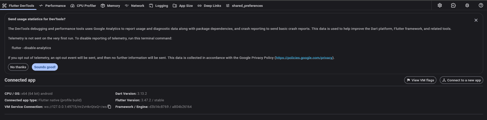
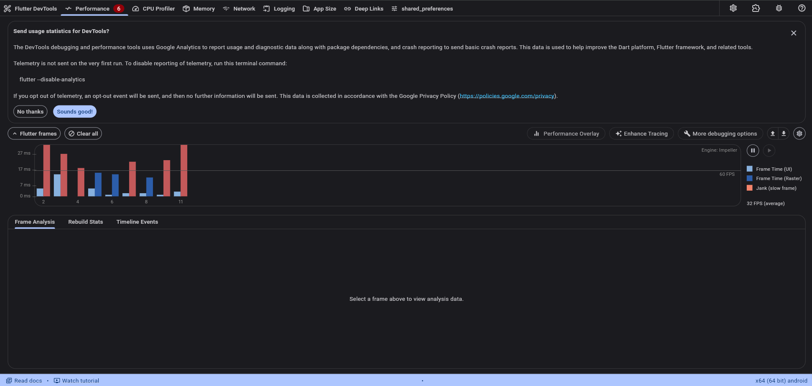
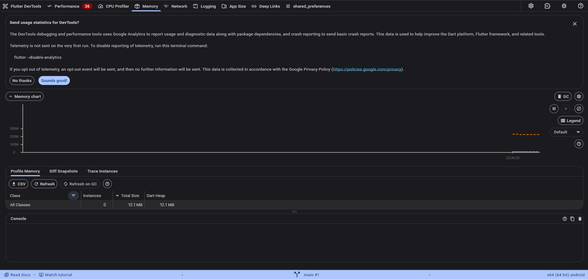
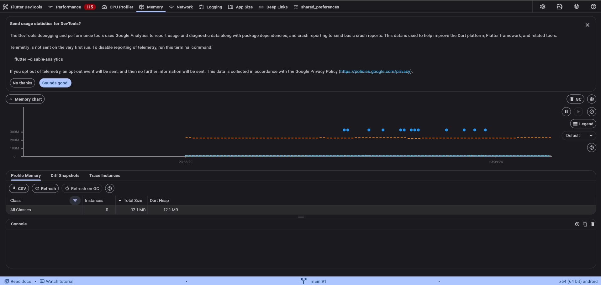
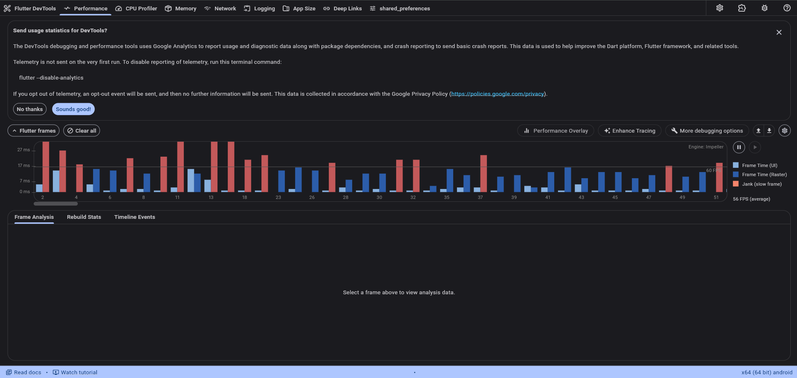
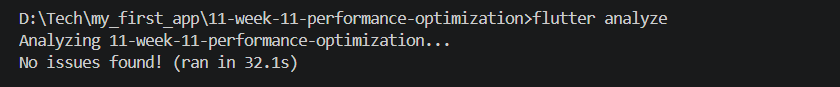
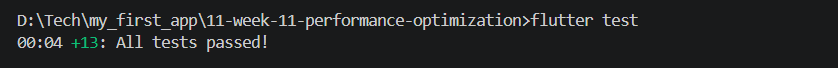

## Jobsheet: Matkul Mobile Programming Week 11

| *Informasi* | *Detail* |
| --- | --- |
| Mata Kuliah | Mobile Programming |
| Nama | Joseph Atem Deng Aruei |
| Absen | 17 |
| NIM | 244107020242 |

## Objective

Continue the existing Offline Notes app and improve responsiveness with measured, targeted Flutter performance work. The project retains its Week 10 notes, title search, offline mode, AI study chat, and cached posts while focusing this week on rebuild isolation, search work, lazy list rendering, and profiling.

## Main features

- Notes remain stored locally in SQLite and searchable by title.
- Search waits briefly after typing before filtering, reducing repeated full-list work.
- Offline status, sync status, and the notes list are separate reactive subtrees.
- The notes list uses `ListView.builder` and is isolated in a repaint boundary.
- Existing AI chat, cached posts, and settings remain accessible.

## Performance changes

1. **Isolated rebuilds:** the notes page no longer watches changing note, sync, and offline providers at its root. The offline banner, sync row, and list each watch only the state they display.
2. **Debounced and scoped title search:** updates are applied after 250 ms of inactivity. Search state and family results are auto-disposed when the notes screen is left.
3. **Paint isolation:** the lazy notes list sits inside a `RepaintBoundary`, separating its scrolling paint layer from the banner and sync controls.
4. **Lazy construction retained:** both notes and cached posts use `ListView.builder`; this avoids building off-screen rows. The current notes feature has no remote image feed, so image resizing and image-cache changes were not added without an image workload to optimize.

The DevTools captures below record the profile sessions. They show an average of **32 FPS before** and **56 FPS after** the changes (approximately **31.3 ms** and **17.9 ms per frame**, calculated as 1,000 ÷ FPS). The memory profile table shows **12.1 MB Dart heap** in both captures. The before/after captures are visual session evidence; their recorded durations differ, so the FPS values are observational rather than a controlled benchmark.

## Architecture and tech stack

```text
Flutter pages/widgets
        ↓ reads/watches
Riverpod presentation providers
        ↓
Domain note entity + title filter
        ↓
SQLite note repository / HTTP cached-post sync
```

- Flutter and Dart
- Riverpod for state and dependency wiring
- SQLite (`sqflite`) for notes and cached posts
- GoRouter for navigation
- Dio and `http` for existing network features
- `flutter_secure_storage` for the existing user-managed AI key

## Run the app

From this folder:

```sh
flutter pub get
flutter analyze
flutter test
flutter run --profile
```

For CPU profiling, open Flutter DevTools from the running Flutter tool session and select **Performance**. The recorded scenarios include list interaction and scrolling. Use **Memory** to compare the heap profile before and after note navigation. The results and interpretation are in [Performance report](docs/performance-report.md).

## Verification

The project checks completed successfully:

| Check | Result |
| --- | --- |
| `flutter analyze` | Passed — no issues found |
| `flutter test` | Passed — all 13 tests |

## Performance evidence

The report and findings are in [`docs/performance-report.md`](docs/performance-report.md) and [`docs/performance-findings.md`](docs/performance-findings.md). The screenshots are embedded below so they render in the repository preview.

### DevTools connected to the profile build



### Performance before optimization



### Memory profile before note navigation



### Memory profile after note navigation



### Performance after optimization



### Static analysis



### Automated tests



## Reflection

- **Largest observed impact:** DevTools showed 32 FPS in the before capture and 56 FPS in the after capture. Because the captures have different durations, this is directional evidence rather than a controlled benchmark.
- **How verified:** compared the Performance and Memory views and kept the analyzer and test results alongside the captures.
- **Trade-offs:** the 250 ms delay makes results appear slightly after typing; a repaint boundary can add layer memory and should remain only if profiling supports it. Small local notes lists may not show a measurable frame-time change.
- **Avoiding premature optimization:** start with a reproducible profile and optimize a measured bottleneck. Do not add pagination, image caching, or more complex caching when the current screen has no corresponding workload.

## Result

The code changes scope provider rebuilds to the widgets that depend on each value, delay title filtering until typing pauses, dispose transient search provider entries, and isolate the lazy notes list’s paint layer. The captured profile sessions show higher average FPS after the changes, while the memory profile table shows a 12.1 MB Dart heap in both captures.
