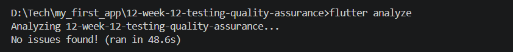
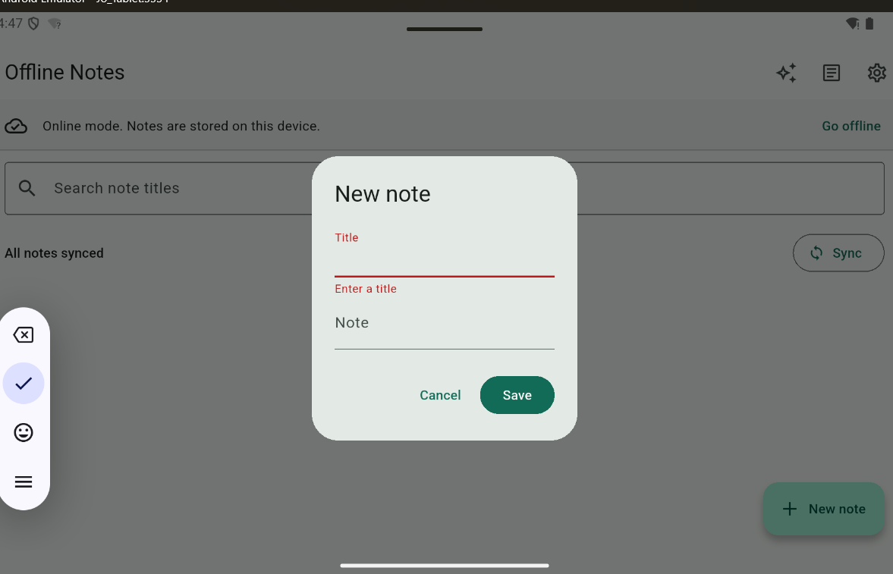
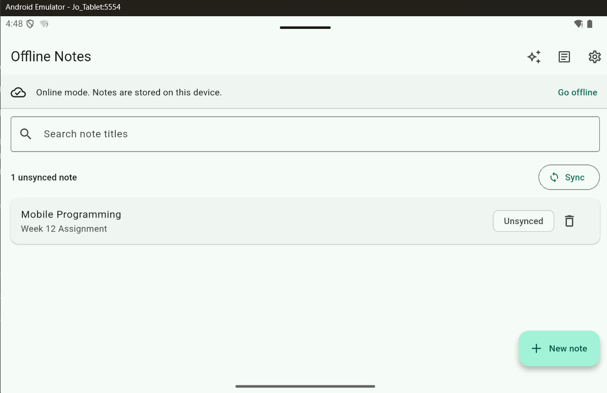
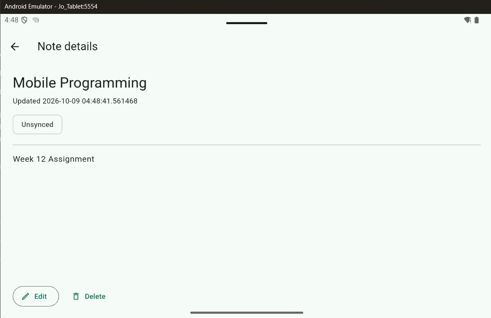
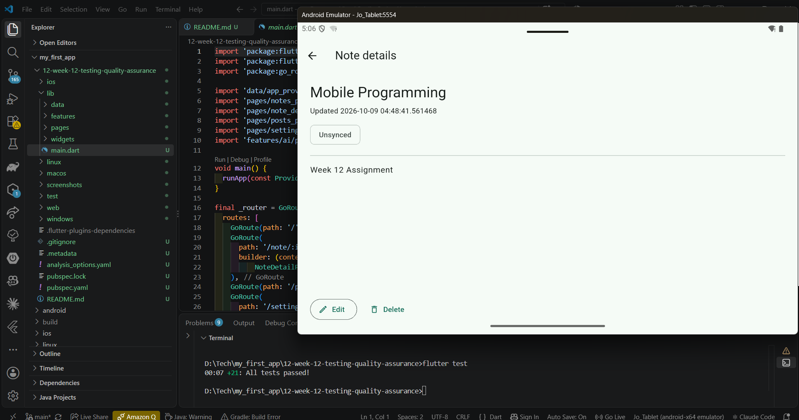
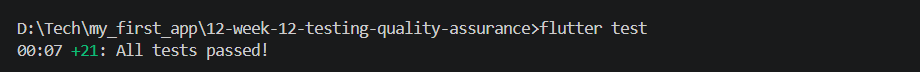

## Jobsheet: Matkul Mobile Programming Week 12

| *Informasi* | *Detail* |
| --- | --- |
| Mata Kuliah | Mobile Programming |
| Nama | Joseph Atem Deng Aruei |
| Absen | 17 |
| NIM | 244107020242 |

This project continues the Offline Notes app and adds a focused test suite for note creation, validation, repository failures, and the main note-taking flow.

## Test strategy

| Test level | What is covered | Test file |
| --- | --- | --- |
| Unit | Note title accepts non-whitespace input and rejects empty, whitespace-only, and missing input. | `test/features/notes/domain/note_title_validator_test.dart` |
| Widget | Empty-title validation, saving a note, save errors, and note-load errors with retry UI. | `test/features/notes/presentation/notes_page_test.dart` |
| Integration | Create a note through the app, find it in the list, open it, and verify its detail view. | `integration_test/app_test.dart` |

The widget tests inject a fake note repository. This keeps the cases deterministic and lets the tests produce both successful data and controlled database errors without network or device state.

## Changes made

- Extracted note-title validation into `lib/features/notes/domain/validators/note_title_validator.dart` so the rule can be tested independently.
- Added unit tests for valid and invalid title inputs.
- Added widget tests for the note creation form and repository success/error states.
- Added an integration test for the create-and-open-note flow.
- Updated the note form to save field values before dismissing the dialog. This avoids disposing text controllers while the dialog is still animating out.
- Added stable keys to the title and body fields so widget and integration tests can enter text into the intended field without ambiguous finders.
- Added Flutter's `integration_test` SDK dependency and assigned this app its own Week 12 Android package identifier.

## Screenshots













## Verification record

| Check | Result |
| --- | --- |
| `dart format lib test integration_test` | Dart sources are formatted. |
| `flutter analyze` | Passed with no issues. |
| `flutter test test/features/notes/domain/note_title_validator_test.dart` | Passed: 4 tests. |
| Full `flutter test` suite | Passed: terminal output reports all 21 tests passed. |
| Integration test | `integration_test/app_test.dart` verifies creating a note and opening its detail view on a device. |

The tests cover successful note creation, blank-title validation, repository save failure, and note-loading failure. Coverage shows which code ran during tests; important branches and edge cases still need direct assertions.

## Run the checks

From this directory, run:

```powershell
flutter pub get
flutter analyze
flutter test
flutter test --coverage
flutter devices
flutter test integration_test/app_test.dart -d <device_id>
```

Coverage is a guide for finding untested branches; it does not prove that every important behavior has been checked.

## Reflection

- **Bug easiest to miss without tests:** a title containing only spaces looks filled in unless validation trims whitespace before deciding whether it is empty.
- **Where a fake was needed:** the note repository is replaced in widget tests. The fake returns controlled notes or throws on demand, so save and load error states are repeatable without a live database or network.
- **What widget and integration tests show:** widget tests check what the user sees when the form is invalid and after successful or failed repository actions. The integration test checks that the full app flow carries a newly created note from the form into the list and detail page.

